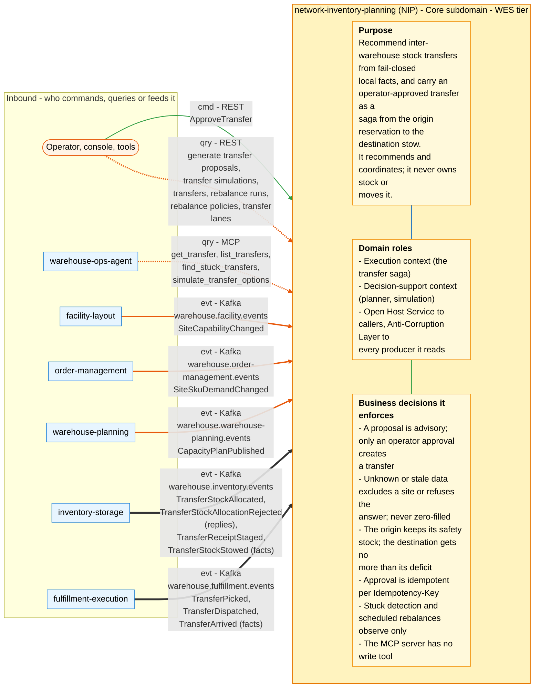
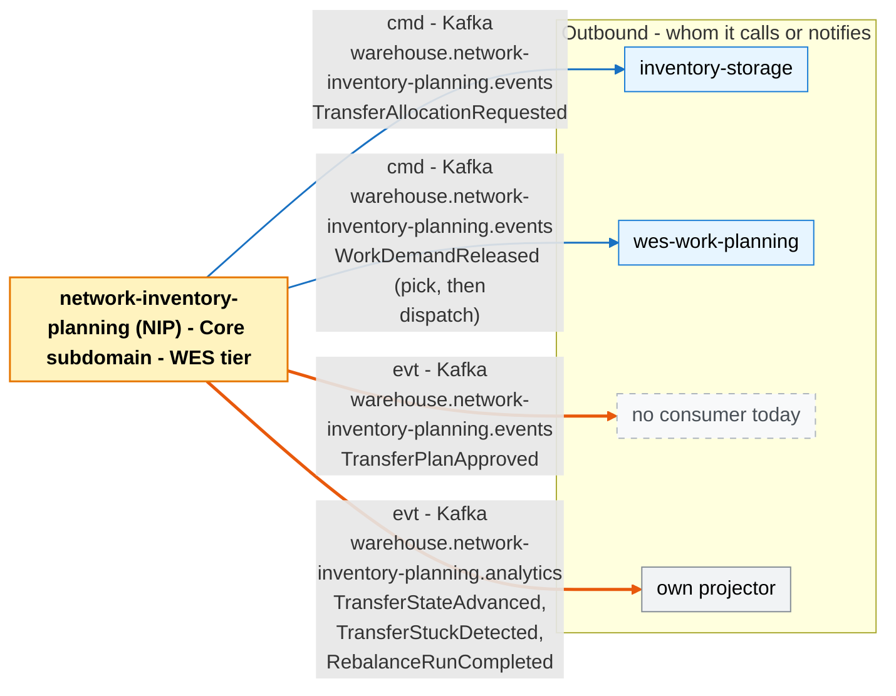

# Bounded context canvas

Following the ddd-crew [Bounded Context Canvas v5](https://github.com/ddd-crew/bounded-context-canvas).

## Canvas at a glance

Two pictures of the sections below, laid out like the ddd-crew canvas:
first the inbound collaborators feeding this context (purpose, domain roles
and the business decisions it enforces), then the outbound collaborators it
calls or notifies. Arrows follow the message type: **solid blue**
commands (`cmd`), **dotted green** queries (`qry`), **thick orange** events
(`evt`); each arrow names its channel and the messages it carries. Box shapes
mark the collaborator kind: rounded = people, UI or any client; blue =
sibling bounded context; double border = external system or platform;
grey = this context's own projector, reports or dead-letter path; dashed =
published today with no consumer. Channel names on the arrows are
abbreviated (REST, MCP, Kafka, HTTP, port); the Inbound and Outbound
Communication tables carry the exact route, tool, topic and CloudEvents
type for every message.

### Inbound

### Outbound

Source: the Inbound Communication and Outbound Communication tables of this
page, which map to `internal/adapters/inbound/{http,kafka,mcp}` and `internal/adapters/outbound/`. The diagram omits assumptions, verification metrics, open
questions and the ubiquitous language (sections below), the relationship
pattern per message (OHS, ACL, Conformist, Customer/Supplier - see the
tables) and anything the tables mark as deprecated or platform-only
(health probes).

## Name

`network-inventory-planning` (NIP). CloudEvents prefix
`com.warehouse.wes.network-inventory-planning.`, source
`/warehouse/network-inventory-planning`.

## Purpose

Recommend inter-warehouse stock transfers from fail-closed local facts, and
carry an operator-approved transfer as a saga from the origin reservation to
the destination stow. It recommends and coordinates; it never becomes the
inventory ledger and never moves stock itself (ADR 0001).

## Strategic classification

| Axis | Value | Evidence |
| --- | --- | --- |
| Domain | **Core** | ADR 0001; [Subdomain classification](./subdomain-classification.md), [Core domain chart](./core-domain-chart.md) |
| Business model | Cost reduction and service level: cover one site's deficit with another's surplus | ADR 0001 |
| Evolution | Custom-built, early | twelve ADRs, explicit v1 simplifications |

## Domain roles

- **Execution context** for the transfer saga: other contexts' facts drive a
  state machine it owns.
- **Decision-support context** for the planner and the advisory simulation.
- **Open Host Service** with a Published Language (REST, read-only MCP, Kafka)
  towards its callers; **Anti-Corruption Layer** towards every producer it
  reads (each payload is hand-mirrored into local structs and read models).

## Inbound communication

| Counterpart | Message | Kind | Handled by |
| --- | --- | --- | --- |
| facility-layout | `SiteCapabilityChanged` | event | `site_capability` read model |
| order-management | `SiteSkuDemandChanged` | event | `site_sku_demand` read model |
| warehouse-planning | `CapacityPlanPublished` | event | `published_capacity_plan` read model |
| inventory-storage | `TransferStockAllocated`, `TransferStockAllocationRejected` | reply | `ApplyTransferAllocation`, `ApplyTransferRejection` |
| inventory-storage | `TransferReceiptStaged`, `TransferStockStowed` | fact | `ApplyTransferReceiptStaged`, `ApplyTransferStow` |
| fulfillment-execution | `TransferPicked`, `TransferDispatched`, `TransferArrived` | fact | `ApplyTransferPick`, `ApplyTransferDispatched`, `ApplyTransferArrival` |
| operator / console | `POST /v1/transfers:approve` | command | `ApproveTransfer` |
| operator / console / tools | `POST /v1/transfer-proposals:generate`, `GET /v1/transfer-simulations`, `GET /v1/transfers`, `GET /v1/transfers/{id}`, `GET /v1/rebalance-runs`, `GET /v1/rebalance-policies`, `GET /v1/transfer-lanes` | query | planner, read models, saga store |
| warehouse-ops-agent | `get_transfer`, `list_transfers`, `find_stuck_transfers`, `simulate_transfer_options` | query (MCP) | read side |

## Outbound communication

| Counterpart | Message | Kind | Topic |
| --- | --- | --- | --- |
| inventory-storage | `TransferAllocationRequested` | command | `warehouse.network-inventory-planning.events` |
| wes-work-planning | `WorkDemandReleased` (pick, then dispatch) | command | `warehouse.network-inventory-planning.events` |
| no consumer today | `TransferPlanApproved` | event | `warehouse.network-inventory-planning.events` |
| own projector | `TransferStateAdvanced`, `TransferStuckDetected`, `RebalanceRunCompleted` | analytics occurrence | `warehouse.network-inventory-planning.analytics` |

Everything leaves through the transactional outbox, in the same transaction as
the state change that justifies it.

## Ubiquitous language

See [Ubiquitous language](./ubiquitous-language.md): InterWarehouseTransfer,
Proposal, ScoreBreakdown, PlanningSnapshot, SiteCapability, SiteSkuDemand,
PublishedCapacityPlan, WorkDemand, StuckTransfer, RebalanceRun.

## Business decisions

- A proposal is advisory; only an operator approval creates a transfer.
- Unknown or stale data excludes a site or refuses the answer; it is never
  zero-filled.
- The origin keeps its safety stock; the destination gets no more than its
  deficit; only an enabled directed lane carries a proposal with a positive
  score.
- Approval is idempotent per `Idempotency-Key`; the same key with a different
  body is `409 idempotency-conflict`.
- Without a configured pick path approval answers `503 config-incomplete` and
  persists nothing.
- A short pick is recorded and the dispatch leg carries what was picked; a
  missing dispatch configuration commits `PICKED` and withholds only the
  dispatch demand.
- Stuck detection and scheduled rebalances observe only: they never change a
  transfer, approve or allocate (ADR 0007).
- The MCP server has no write tool (ADR 0008).
- A transfer can be cancelled only before allocation, and nothing invokes
  cancellation today.

## Assumptions

- The upstream payloads are as mirrored in `apis/asyncapi.yaml`; a legacy
  `CapacityPlanPublished` without `site_id` is excluded.
- inventory-storage honours the closed rejection reasons and the
  `<transfer_id>:1` line id; on its side the transfer consumer runs only when
  `TRANSFER_ALLOCATION_CONSUMER_MODE=kafka`.
- wes-work-planning knows the configured `path_id` values (the reference
  deployment uses `pick` and `transfer-dispatch`).
- `TransferArrived` may never fire; `TransferReceiptStaged` drives the same
  transition.

## Verification metrics

- End-to-end saga and read-model integration tests against testcontainers
  Kafka and Postgres; 188 BDD scenarios; architecture fitness tests pinning the
  event catalogue (ADR 0004) and the layering.
- Operationally: `/reports/transfer-funnel`, `/reports/state-dwell`,
  `/reports/stuck-transfers`, `/reports/rebalance-runs`, `/reports/freshness`.

## Open questions

- **Stock positions on the read-model path.** Scheduled runs plan from the
  operator-managed policy and lane catalogues (ADR 0015) on a site-level
  approximation (capacity headroom and demand), because no sibling publishes
  per-site stock positions.
- **Cancellation after allocation** needs an explicit reservation revocation
  that is not designed.
- **Analytics coverage of the physical tail.** `TransferStateAdvanced` is not
  emitted for `PICKED → IN_TRANSIT`, `→ ARRIVED`, `→ RECEIVED` or
  `→ UNFULFILLABLE` because those use cases are wired without a publisher.
- **Mismatched allocation replies** are retried forever instead of being
  skipped (see [Troubleshooting](../operations/troubleshooting.md)).
- **Per-state dwell.** `age_seconds` is age since creation, so
  `/reports/state-dwell` approximates time in state.
- Auto-approval, route optimisation and forecasting are not built.
